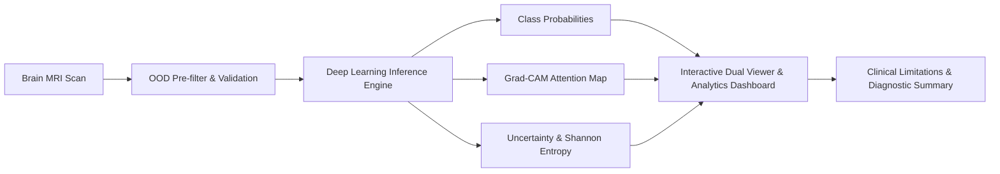

# NeuroGuide AI 🧠
### Brain MRI Classification, Explainable AI (Grad-CAM) & Clinical Uncertainty Platform

[](https://www.python.org/)
[](https://fastapi.tiangolo.com/)
[](https://pytorch.org/)
[](LICENSE)

**NeuroGuide AI** is a production-ready, medical-educational AI system designed to assist in brain MRI diagnostic interpretation. It bridges the gap between deep learning predictions, clinical visual interpretability, and quantitative diagnostic uncertainty.

---

## 🌟 Key Features

- **Multi-Class Tumor Classification**: Differentiates between **Glioma**, **Meningioma**, **Pituitary Tumor**, and **No Tumor (Healthy)**.
- **Explainable AI (Grad-CAM)**: Visualizes model attention with interactive gradient-weighted class activation mapping, customizable colormaps, opacity sliders, and automated Region of Interest (ROI) quadrant localization.
- **Uncertainty & Clinical Risk Quantification**: Calculates predictive Shannon entropy and confidence margins to flag ambiguous scans.
- **Out-of-Distribution (OOD) Pre-filtering**: Detects corrupted, non-MRI, or non-brain inputs before feeding them to the neural network.
- **Interactive Full-Stack Web Interface**: Modern, dark-mode glassmorphic frontend with dual-pane scan comparison, preset sample library, and real-time diagnostic reporting.
- **Comprehensive Test Suite**: Automated verification covering data pipelines, preprocessing, inference, explainability, and REST endpoints.

---

## 🏗️ System Architecture



---

## 📁 Repository Structure

```text
NeuroGuide AI/
├── backend/
│   ├── app/
│   │   ├── api/             # FastAPI route handlers (/predict, /samples, /health)
│   │   ├── core/            # Model architecture, Grad-CAM, preprocessor, uncertainty
│   │   ├── config.py        # Application settings and paths
│   │   └── main.py          # FastAPI application factory & CORS setup
│   └── samples/             # Sample MRI scans for demo gallery
├── frontend/
│   ├── index.html           # Single-page diagnostic dashboard
│   ├── scripts/             # Modular JS (API client, viewer, state management)
│   └── styles/              # Glassmorphic CSS design system
├── tests/                   # Automated pytest suite
├── training/                # Training routines, dataset preparation, evaluation
├── requirements.txt         # Python dependencies
├── pytest.ini               # Test configuration
└── README.md                # Project documentation
```

---

## 🚀 Getting Started

### 1. Prerequisites
- **Python 3.10+**
- Recommended: Virtual environment (`venv` or `conda`)

### 2. Installation

Clone this repository and set up the Python environment:

```bash
git clone https://github.com/lohitakshsinha/NeuroGuide-AI.git
cd NeuroGuide-AI

# Create virtual environment
python -m venv .venv

# Activate virtual environment
# Windows:
.venv\Scripts\activate
# Linux/macOS:
source .venv/bin/activate

# Install dependencies
pip install -r requirements.txt
```

### 3. Running the Backend

Launch the FastAPI application:

```bash
uvicorn backend.app.main:app --reload --port 8000
```
- API Docs: [http://localhost:8000/docs](http://localhost:8000/docs)
- Health Check: [http://localhost:8000/health](http://localhost:8000/health)

### 4. Running the Frontend

Serve the `frontend/` folder using any static server or Python HTTP server:

```bash
python -m http.server 3000 --directory frontend
```
Navigate to [http://localhost:3000](http://localhost:3000) in your browser.

---

## 🧪 Running Automated Tests

Run the full pytest suite:

```bash
pytest
```

---

## ⚠️ Clinical Disclaimer

> **For Educational and Research Purposes Only**  
> NeuroGuide AI is an assistive decision-support research tool and is **NOT** a certified medical diagnostic device. It should never be used as a standalone substitute for professional radiologist evaluation, histopathological confirmation, or clinical diagnosis.
