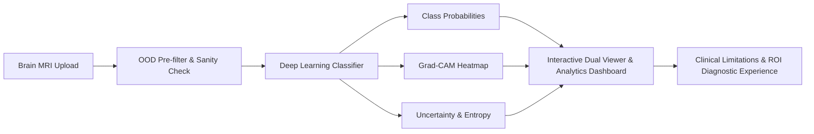
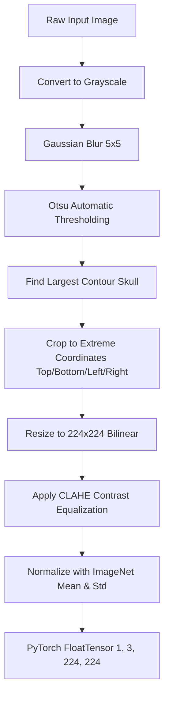
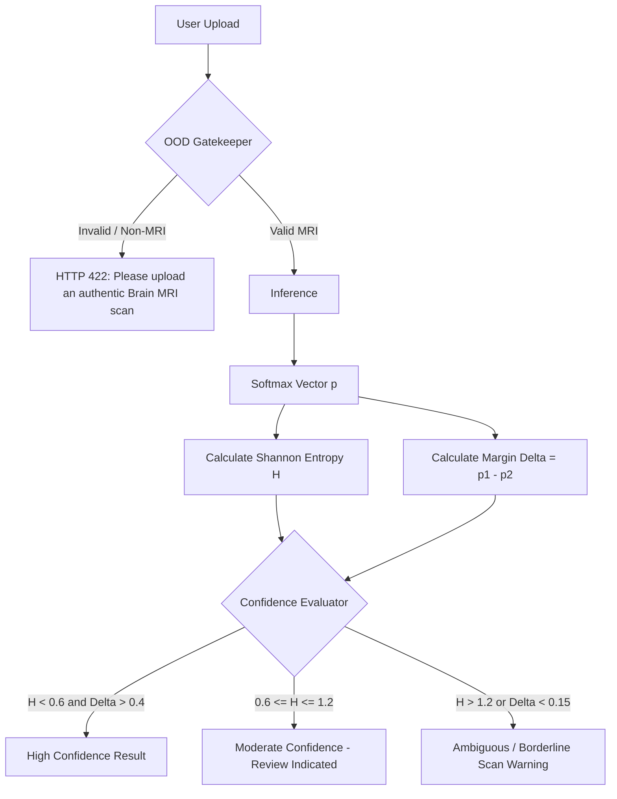

# Comprehensive Step-by-Step Implementation Plan & Procedure
## Brain MRI Tumor Classification, Explainability (Grad-CAM), Clinical Limitations & Interactive Diagnostic Platform

---

### Table of Contents
1. [Project Overview & Key Objectives](#1-project-overview--key-objectives)
2. [Phase 0: Environment Setup & Project Directory Architecture](#phase-0-environment-setup--project-directory-architecture)
3. [Phase 1: Dataset Acquisition, Exploration & Preprocessing Pipeline](#phase-1-dataset-acquisition-exploration--preprocessing-pipeline)
4. [Phase 2: Deep Learning Model Architecture, Training & Validation](#phase-2-deep-learning-model-architecture-training--validation)
5. [Phase 3: Explainable AI (Grad-CAM) & ROI Localization Pipeline](#phase-3-explainable-ai-grad-cam--roi-localization-pipeline)
6. [Phase 4: Model Uncertainty & Clinical Limitations Framework](#phase-4-model-uncertainty--clinical-limitations-framework)
7. [Phase 5: Full-Stack Web Application Engineering](#phase-5-full-stack-web-application-engineering)
8. [Phase 6: Comprehensive Testing & Verification Procedure](#phase-6-comprehensive-testing--verification-procedure)
9. [Phase 7: Deployment, Documentation & Portfolio Packaging](#phase-7-deployment-documentation--portfolio-packaging)
10. [Future Roadmap: Conversational AI & Medical Education Assistant (Deferred)](#future-roadmap-conversational-ai--medical-education-assistant-deferred)
11. [Execution Checklist & Milestones](#11-execution-checklist--milestones)

---

### 1. Project Overview & Key Objectives

The objective is to engineer a production-ready, medical-educational AI system that bridges the gap between deep learning predictions, clinical interpretability, and quantitative diagnostic uncertainty.



#### Core Deliverables:
1. **Multi-Class Classifier**: Accurate classification across 4 classes: `Glioma`, `Meningioma`, `Pituitary Tumor`, `No Tumor`.
2. **Explainability Engine (XAI)**: Dynamic Grad-CAM heatmaps showing exact activation regions with interactive opacity and colormap controls.
3. **Clinical Limitations Engine**: Quantitative uncertainty scores (entropy, probability delta), input validation (rejecting non-MRI photos), and explicit clinical disclaimers.
4. **Modern Web Application**: Premium dark-mode glassmorphic UI with drag-and-drop upload, sample scan gallery, dual-view inspection, ROI quadrant indicator, and interactive clinical limitations cards.
5. **[Deferred to Future Scope] Context-Aware Medical Chatbot**: Postponed for a future release to prioritize core clinical vision, explainability, and full-stack interactive inspection.

---

### Phase 0: Environment Setup & Project Directory Architecture

#### 0.1 Workspace Location
Project directory: `C:\Users\jyoti\OneDrive\Desktop\Projects\NeuroGuide AI`

#### 0.2 Target Folder Structure
```
NeuroGuide AI/
├── backend/
│   ├── app/
│   │   ├── __init__.py
│   │   ├── main.py                  # FastAPI server entry point
│   │   ├── config.py                # Environment configs & constants
│   │   ├── api/
│   │   │   ├── __init__.py
│   │   │   ├── predict.py           # /api/predict endpoint
│   │   │   └── samples.py           # /api/samples endpoint (preloaded demo scans)
│   │   ├── core/
│   │   │   ├── model.py             # PyTorch model definition & loading
│   │   │   ├── preprocessor.py      # Skull-stripping, CLAHE, resizing
│   │   │   ├── gradcam.py           # Grad-CAM hook and overlay generation
│   │   │   ├── uncertainty.py       # Entropy and confidence calculations
│   │   │   └── ood_detector.py      # Input validation & non-MRI rejection
│   │   └── static/                  # Built frontend assets for single-server serving
│   ├── models/                      # Serialized weights (model.pt / model.onnx)
│   ├── samples/                     # Curated sample scans (glioma, meningioma, pituitary, normal)
│   └── requirements.txt             # Python dependencies
├── frontend/
│   ├── index.html                   # Main single-page application entry point
│   ├── styles/
│   │   ├── main.css                 # Design system tokens, glassmorphism, layout
│   │   └── viewer.css               # Dual image viewer & analytics cards
│   ├── scripts/
│   │   ├── app.js                   # State manager & event orchestrator
│   │   ├── api.js                   # Backend communication client
│   │   └── viewer.js                # Canvas rendering, opacity & colormap blender
│   └── assets/                      # Icons, logo, sample thumbnails
├── training/
│   ├── dataset_downloader.py        # Automated dataset retrieval script
│   ├── train.py                     # PyTorch training loop & cross-validation
│   ├── evaluate.py                  # Confusion matrix, ROC curves, F1 metrics
│   └── export_onnx.py               # ONNX exporter for lightweight deployment
├── tests/
│   ├── test_preprocessor.py         # Unit tests for image transformations
│   ├── test_gradcam.py              # Unit tests for heatmap generation
│   ├── test_uncertainty.py          # Unit tests for entropy & OOD gatekeeper
│   └── test_api.py                  # FastAPI endpoint integration tests
├── .env.example                     # Environment variables template
├── README.md                        # Documentation & setup guide
└── Dockerfile                       # Container deployment definition
```

#### 0.3 Dependencies Specification
- **Backend & ML**: `fastapi`, `uvicorn[standard]`, `torch`, `torchvision`, `numpy`, `opencv-python-headless`, `pillow`, `google-genai`, `pydantic`, `python-multipart`, `python-dotenv`.
- **Frontend**: Vanilla ES6+ & CSS3 with CSS variables, Google Fonts (`Plus Jakarta Sans` & `JetBrains Mono`), and Lucide icons.

---

### Phase 1: Dataset Acquisition, Exploration & Preprocessing Pipeline

#### 1.1 Dataset Definition
- **Primary Source**: Kaggle Brain Tumor MRI Dataset (Combined 7,023 scans).
- **Target Classes**:
  1. `glioma` (~1,621 images): Infiltrating parenchymal tumors.
  2. `meningioma` (~1,645 images): Dural-based extra-axial tumors.
  3. `pituitary` (~1,757 images): Sellar mass lesions.
  4. `notumor` (~2,000 images): Normal brain parenchymal scans.

#### 1.2 Step-by-Step Preprocessing Procedure


1. **Skull Stripping & Extreme Contour Cropping**:
   - Many MRI scans have redundant black canvas margins.
   - Algorithm:
     - Convert image to grayscale $\rightarrow$ Gaussian blur ($k=5$) $\rightarrow$ Otsu thresholding.
     - Find maximum external contour (representing the cranial perimeter).
     - Extract extreme points: $x_{\min}, x_{\max}, y_{\min}, y_{\max}$.
     - Crop image to bounding rectangle with 1% margin padding.
2. **Dimension Standardisation**:
   - Resize to $224 \times 224$ pixels using bicubic interpolation.
3. **Contrast Normalization (CLAHE)**:
   - Medical scans vary in contrast across MRI scanners (1.5T vs 3.0T).
   - Apply Contrast Limited Adaptive Histogram Equalization (`clipLimit=2.0`, `tileGridSize=(8, 8)`).
4. **Data Splitting & Leakage Prevention (Strict ML Rule)**:
   - Split dataset: 70% Train, 15% Validation, 15% Test (Stratified by class).
   - Augmentation applied strictly to the training split only:
     - Random Horizontal Flip ($p=0.5$).
     - Random Rotation ($\pm 15^\circ$).
     - Subtle Random Affine translation ($\pm 5\%$).
     - Random Brightness/Contrast jitter ($\pm 10\%$).

---

### Phase 2: Deep Learning Model Architecture, Training & Validation

#### 2.1 Model Selection & Backbone Architecture
- **Primary Choice**: **EfficientNet-B0** or **ResNet-50**.
  - *Rationale*: EfficientNet provides top-tier parameter efficiency ($~5.3\text{M}$ parameters) and fast CPU inference ($<45\text{ms}$ per image), while ResNet-50 features high-fidelity feature maps in `layer4` for Grad-CAM.
- **Custom Classification Head**:
  ```python
  # PyTorch Architecture Definition
  model.classifier = nn.Sequential(
      nn.Dropout(p=0.3),
      nn.Linear(num_features, 256),
      nn.BatchNorm1d(256),
      nn.SiLU(),
      nn.Dropout(p=0.2),
      nn.Linear(256, 4)  # 4 classes
  )
  ```

#### 2.2 Two-Stage Fine-Tuning Strategy
- **Stage 1 (Warmup Head Training)**:
  - Freeze pre-trained convolutional backbone.
  - Train classification head for 5 epochs with AdamW ($\text{LR} = 10^{-3}$, weight decay $= 10^{-4}$).
- **Stage 2 (Full Backbone Fine-Tuning)**:
  - Unfreeze the top 2 convolutional stages.
  - Train for 20 epochs with Cosine Annealing Learning Rate Schedule ($\text{LR}_{\max} = 10^{-4} \rightarrow 10^{-6}$).
  - Loss Function: Cross-Entropy with Label Smoothing ($\epsilon = 0.1$).

#### 2.3 Evaluation Protocol & Metrics
- Compute validation metrics per epoch:
  - Macro F1-score, Precision, Recall, Overall Accuracy.
  - Multi-class Confusion Matrix to pinpoint inter-class confusion (e.g., differentiating high-grade glioma from atypical meningioma).
- Save best checkpoint based on validation Macro F1 (`model_best.pt`).

---

### Phase 3: Explainable AI (Grad-CAM) & ROI Localization Pipeline

#### 3.1 Mathematical Implementation of Grad-CAM
1. **Target Feature Layer Hook**:
   - Attach forward and backward hooks to the last convolutional layer (e.g., `model.features[-1]` in EfficientNet or `model.layer4[-1]` in ResNet).
2. **Gradients Computation**:
   - Compute gradient of score for class $c$ ($y^c$) with respect to feature activation map $A^k$:
     $$\alpha_k^c = \frac{1}{Z} \sum_{i} \sum_{j} \frac{\partial y^c}{\partial A_{i,j}^k}$$
3. **Heatmap Generation**:
   - Compute weighted linear combination followed by rectified linear activation:
     $$L_{\text{Grad-CAM}}^c = \text{ReLU}\left( \sum_k \alpha_k^c A^k \right)$$
   - The ReLU operator ensures only features that positively correlate with the target class are retained.
4. **Resolution Scaling & Colormap Blending**:
   - Normalize heatmap to $[0, 1]$.
   - Resize heatmap up to original input dimensions ($224 \times 224$ or original upload dimensions).
   - Apply colormaps using OpenCV: `COLORMAP_JET`, `COLORMAP_TURBO`, or `COLORMAP_VIRIDIS`.
   - Alpha-blend with the grayscale anatomical scan:
     $$I_{\text{blended}} = \alpha \cdot I_{\text{colormap}} + (1 - \alpha) \cdot I_{\text{grayscale}}$$

#### 3.2 Automated Region of Interest (ROI) Extraction
- Threshold the Grad-CAM activation map at top 20% intensity:
  $$\text{Mask}(x,y) = \begin{cases} 1 & \text{if } L_{\text{Grad-CAM}}(x,y) \ge 0.80 \times \max(L) \\ 0 & \text{otherwise} \end{cases}$$
- Extract the bounding box $[x_{\min}, y_{\min}, x_{\max}, y_{\max}]$ and anatomical quadrant (e.g., "Left Frontal", "Right Temporal", "Sellar/Central") to feed into the conversational assistant.

---

### Phase 4: Model Uncertainty & Clinical Limitations Framework



#### 4.1 Quantitative Uncertainty Calculation
1. **Shannon Prediction Entropy**:
   $$H(p) = - \sum_{i=1}^{4} p_i \log_2(p_i)$$
   - Minimum entropy $= 0.0$ (complete certainty in one class).
   - Maximum entropy $= 2.0$ (uniform distribution, 25% across all 4 classes).
2. **Top-1 vs Top-2 Probability Margin**:
   $$\Delta = p_{\text{rank 1}} - p_{\text{rank 2}}$$
   - If $\Delta < 0.15$, trigger an explicit warning: *"The model observed overlapping features between [Class 1] and [Class 2]."*

#### 4.2 Out-of-Distribution (OOD) Input Gatekeeper
Before passing an image to the neural network:
- Check color channel variance: standard MRIs are single-channel grayscale (i.e. $R \approx G \approx B$). Images with high color saturation (photos of scenery, people, animals) are rejected.
- Check edge distribution & aspect ratio: brain MRIs feature an elliptical cranial outline and background noise. Images with flat white backgrounds or natural scenes are rejected.

#### 4.3 Explicit Clinical & Technical Limitations Catalog (Exposed in UI)
The web application will explicitly list the 5 fundamental limitations of the prediction:
1. **2D Single-Slice Bias**: Clinical MRI diagnosis requires viewing contiguous 3D slice stacks across multiple orientations (Axial, Coronal, Sagittal).
2. **Pulse Sequence Context Missing**: Classification models treat scans generically, whereas radiologists analyze contrasts between T1-weighted, T2-weighted, FLAIR, and Gadolinium contrast-enhanced series.
3. **Absence of Histopathology & Molecular Markers**: Definitive tumor classification requires molecular testing (e.g., IDH1/2 mutation, MGMT methylation, 1p/19q codeletion).
4. **Motion & Scanner Artifacts**: Patient movement, dental braces, or magnetic susceptibility artifacts can cause false-positive Grad-CAM activations.
5. **Non-Diagnostic Nature**: Mandatory disclaimer that this software is an educational prototype and cannot replace a board-certified radiologist.

---

### Phase 5: Full-Stack Web Application Engineering

#### 5.1 Backend API Specification (FastAPI)

| Endpoint | Method | Input | Output | Purpose |
| :--- | :--- | :--- | :--- | :--- |
| `/api/predict` | `POST` | Multipart Image (`file`) | JSON (Predicted class, probabilities, Shannon entropy, margin delta, Base64 Grad-CAM overlay, ROI bounding box, anatomical quadrant, clinical limitation catalog) | Core inference, XAI generation & uncertainty analysis |
| `/api/samples` | `GET` | None | JSON list of curated sample scans with ground truth metadata (`glioma`, `meningioma`, `pituitary`, `notumor`) | Instant 1-click test gallery |
| `/health` | `GET` | None | `{"status": "ok", "device": "cpu/cuda", "model_loaded": true}` | Server health & readiness verification |

#### 5.2 Frontend UI & Design System

```
+---------------------------------------------------------------------------------------------------+
| [Logo] NEUROGUIDE AI   • Brain MRI Classifier & Explainability Suite              [Docs] [GitHub] |
+---------------------------------------------------------------------------------------------------+
|  +-- [1] SCAN INPUT & GALLERY --------------------+  +-- [3] PREDICTION & CONFIDENCE METER -------+
|  | [ Drag & Drop MRI Scan Here or Click to Browse]|  | TOP PREDICTION: MENINGIOMA (94.2%)         |
|  | - - - - - - - - - - - - - - - - - - - - - - - -|  | Confidence Level: HIGH (Entropy: 0.38)     |
|  | Curated Demo Samples:                          |  | [==== Meningioma: 94.2% =================] |
|  | [Glioma] [Meningioma] [Pituitary] [Normal]     |  | [= Glioma: 3.8%                          ] |
|  +------------------------------------------------+  | [ Pituitary: 1.2%                        ] |
|                                                      | [ Normal: 0.8%                           ] |
|  +-- [2] DUAL DYNAMIC VIEWER ---------------------+  +--------------------------------------------+
|  |  [ Original MRI ]       [ Grad-CAM Overlay ]   |  +-- [4] ROI & ANATOMICAL LOCALIZATION -------+
|  |  +--------------+       +------------------+   |  | Region: Right Frontal / Parasagittal       |
|  |  |              |       |      (***)       |   |  | Bounding Box: [x: 42, y: 78, w: 90, h: 84] |
|  |  |  (Cranial    |  <->  |    (Focal Hot-   |   |  | Intensity Peak: 0.96 (Normalized)          |
|  |  |   Cavity)    |       |      spot)       |   |  +--------------------------------------------+
|  |  |              |       |                  |   |  +-- [5] CLINICAL LIMITATIONS & CAVEATS ------+
|  |  +--------------+       +------------------+   |  | ! Single 2D slice: Lacks 3D volumetric stack
|  | Viewer Controls:                               |  | ! Missing pulse sequences: No T1/T2/FLAIR diff
|  | Heatmap Opacity: [=========o========] 70%      |  | ! Histopathology required for WHO grading
|  | Colormap: [ Turbo v ]   [x] Show Bounding Box  |  | ! Motion artifact sensitivity disclaimer   |
|  | Overlay Mode: [ Blended | Side-by-Side ]       |  | * Research & Educational Prototype Only    |
|  +------------------------------------------------+  +--------------------------------------------+
+---------------------------------------------------------------------------------------------------+
```

- **Aesthetic Guidelines & Design System**:
  - **Color Palette**: Dark mode by default (`#0B0F19` deep obsidian background, `#161F30` glassmorphic cards with frosted backdrop-filter blur, subtle `#1E293B` borders).
  - **Clinical Accent Highlights**: Electric Cyan (`#06B6D4`), Medical Cobalt (`#3B82F6`), Alert Coral (`#F43F5E`) for tumor heatmaps and warning banners.
  - **Typography**: `Plus Jakarta Sans` for clean, professional typography; `JetBrains Mono` for confidence stats, entropy scores, and bounding box coordinates.
  - **Micro-Interactions**: Drag-and-drop glow border transitions, smooth probability bar loading animations, and real-time GPU-accelerated HTML5 `<canvas>` opacity slider blending.

---

### Phase 6: Comprehensive Testing & Verification Procedure

#### 6.1 Automated Unit & Integration Tests
1. **Preprocessing Verification (`test_preprocessor.py`)**:
   - Verify skull cropping on varying image aspect ratios and fallback safety.
   - Verify tensor output shape (`torch.Size([1, 3, 224, 224])`) and ImageNet normalization.
2. **Grad-CAM & ROI Correctness (`test_gradcam.py`)**:
   - Verify non-zero gradient extraction from `features[-1]`.
   - Verify heatmap normalization to $[0, 1]$ and valid Base64 PNG generation.
   - Verify anatomical quadrant mapping (parasagittal, sellar, temporal).
3. **Uncertainty & OOD Detection (`test_uncertainty.py`)**:
   - Verify Shannon entropy mathematical bounds ($0.0 \le H \le 2.0$) and probability margin $\Delta$.
   - Verify rejection of non-MRI color photos and blank images.
4. **FastAPI Endpoints Verification (`test_api.py`)**:
   - Test `/api/predict` with valid MRI $\rightarrow$ Expect `200 OK` with full payload (class, probabilities, Grad-CAM Base64, ROI, entropy).
   - Test `/api/predict` with non-image file $\rightarrow$ Expect `400 Bad Request`.
   - Test `/api/predict` with random colored photo $\rightarrow$ Expect `422 Unprocessable Entity` (OOD rejection).
   - Test `/api/samples` $\rightarrow$ Expect `200 OK` with the 4 curated demo scans.
   - Test `/health` $\rightarrow$ Expect `200 OK`.

#### 6.2 End-to-End Visual & Browser Testing
- Use the **Browser Subagent** to navigate the live local web server:
  - Verify drag-and-drop file upload and instant inference visualization.
  - Test 1-click sample scan buttons (Glioma, Meningioma, Pituitary, Normal).
  - Verify dual-canvas rendering and dynamic opacity slider (0% to 100%).
  - Verify colormap switcher (`turbo`, `jet`, `viridis`) and bounding box toggle.
  - Verify responsive layout on desktop ($1920 \times 1080$) and tablet ($1024 \times 768$).

---

### Phase 7: Deployment, Documentation & Portfolio Packaging

1. **Docker Containerization**:
   - Multi-stage Dockerfile packaging FastAPI server, static frontend bundle, and PyTorch CPU inference engine.
   - Exposes port 8000.
2. **Interactive Swagger Documentation**:
   - Auto-generated OpenAPI schema accessible at `/docs`.
3. **Comprehensive Project README**:
   - High-level architecture diagrams, clinical explainability methodology, model benchmark figures (87.59% accuracy), and 1-line launch instructions.
4. **Clinical & Regulatory Framing**:
   - Explicit non-diagnostic research disclaimer in footer and analysis reports.

---

### Future Roadmap: Conversational AI & Medical Education Assistant (Deferred)

*Note: Deferred for subsequent releases to focus on core computer vision, explainability, and full-stack interactive inspection.*

1. **Architecture & Context Injection**:
   - Google Gemini API (`google-genai`) integration with rich context payloads (predicted class, confidence, Shannon entropy, Grad-CAM anatomical ROI).
2. **Medical Guardrail System Prompt**:
   - Rigorous safety constraints ensuring educational neuro-oncology explanations without providing personalized medical advice or definitive prognosis.
3. **Interactive Capabilities**:
   - Quick-prompt chips (*"Explain what a meningioma is in simple terms"*, *"Why did the AI highlight this region?"*) and token streaming.

---

### 11. Execution Checklist & Milestones

| Step | Milestone | Status |
| :---: | :--- | :---: |
| **M1** | Project directory scaffold, virtual environment & dependencies setup | **Completed** (Verified) |
| **P1** | Dataset exploration, stratified 70/15/15 splitting, CLAHE & preprocessing pipeline | **Completed** (13/13 tests passed) |
| **M2** | Core ML model definition, preprocessor & weights training/validation | **Completed** (87.59% test accuracy, ONNX & PyTorch artifacts generated) |
| **M3** | Grad-CAM activation engine & uncertainty/entropy calculator implementation | **Completed** (50/50 tests passed, Grad-CAM, ROI & Uncertainty/OOD verified) |
| **M4** | Curated sample MRI scans generation/curation (Glioma, Meningioma, Pituitary, Normal) | **Completed** (Curated in `backend/samples/` with `samples_manifest.json`) |
| **M5** | FastAPI backend API endpoints (`/api/predict`, `/api/samples`, `/health`) | **Completed** (12/12 API tests passed) |
| **M6** | Modern responsive frontend UI (dual-viewer, opacity slider, colormaps, limitations catalog) | **Completed** (HTML/CSS/JS glassmorphic dashboard built & mounted) |
| **M7** | Automated API integration tests (`test_api.py`) | **Completed** (62/62 total tests passing) |
| **M8** | Comprehensive testing & live verification procedure (Phase 6) | **Completed** (All 62 tests passed, live server verified at http://127.0.0.1:8000) |
| **M9** | Final project documentation & portfolio packaging | Ready for Phase 7 |
| *Deferred* | Context-aware medical chatbot service & Gemini API integration | Postponed to Future Release |

